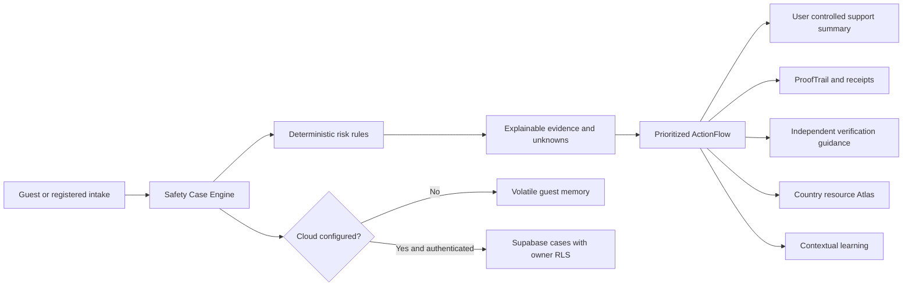

# KinSignal integrated architecture — evidence-backed technical overview

The Safety Case Engine owns versions, historical reassessments, user-confirmed actions and event timeline.

## Trust boundaries
- User input is untrusted and can contain malicious instructions. Rule evaluation does not execute them.
- Assessment labels rule-inferred indicators as warning signals, not independently verified identity.
- URL check parses strings only; no outbound requests.
- Support request generation is local; copying text is not sending, receiving or acknowledging.
- Guest cases have no backend persistence; opt-in authenticated cases require dedicated Supabase configuration.
- Case database authorization uses user-owned RLS. Real cross-account penetration tests are still required.
- Unpublished guidance and official resources are not automatically transformed into authoritative local advice.
- No private uploads, AI model provider, emergency dispatch or email adapter currently active.

## Architecture decision
A modular Next.js application is appropriate for the initial product. Avoid distributing sensitive personal safety actions among unrelated microservices before authorization and persistence are tested.
